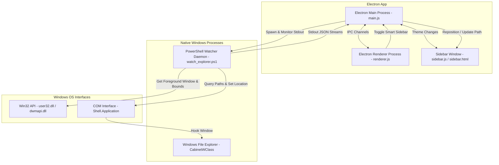

# 🌳 Folder Tree Explorer

[](https://opensource.org/licenses/ISC)
[](https://microsoft.com/windows)
[](https://www.electronjs.org/)
[](https://github.com/PowerShell/PowerShell)

**Folder Tree Explorer** is a Windows desktop folder browser built with Electron. Browse a hierarchical tree, filter and sort files, save favorite folders, and preview files alongside the tree. An optional **Smart Explorer Sidebar** follows the active Windows File Explorer window.

---

## 📌 The Problem It Solves

While the native Windows File Explorer is capable, it has several limitations for power users and developers:
1. **Rigid Navigation Pane**: The built-in navigation pane does not support advanced directory filtering, size calculations, or complex sorting inside the tree itself.
2. **No Side-by-Side Previews**: Previewing markdown files, code, audio, and video requires opening external apps or using slow, non-configurable preview panes.
3. **No Direct Folder Companion Mode**: There is no official way to have a lightweight, persistent tree pane dock and follow you as you open and browse different directories in native File Explorer windows.

In standalone mode, the app displays a folder tree beside media and plain-text/code previews with line numbers. Smart Sidebar mode provides a compact companion tree beside Windows File Explorer; this native docking feature remains beta.

---

## ✨ Main Application Features

*   **⚡ Lazy-Loaded Folder Tree**: Subfolders load when expanded. Scans run in background workers, and large tree listings render in batches. Very large directories can still use substantial memory.
*   **🔍 Type-Specific File Filters**: Show only images, PDF documents, Word documents, Excel/CSV spreadsheets, or PowerPoint presentations. Recursive filtering supports progress and cancellation.
*   **📊 Smart Sorting**: Group directories first and sort files by Name (A-Z or Z-A), Size (Smallest or Largest first), or Date Modified (Newest or Oldest first).
*   **💾 Folder size caching**: Computes directory sizes in the background and caches complete results until the root is reopened or refreshed.
*   **👁️ Rich In-App Previews**:
    *   *Images*: Centered viewer with transparency check grids.
    *   *Audio/Video*: Native HTML5 players with playback speed and volume controls.
    *   *Code/Text*: Renders text/code files under 50KB with line numbering.
    *   *Document Placeholders*: Shows clear metadata and action buttons to open unsupported documents (Word, Excel, PDF) in their native system programs.
*   **📍 Favorites (Pinned Folders)**: Pin frequently accessed folder paths to the sidebar for quick switching. Favorites are persisted across sessions in `localStorage`.
*   **📋 Clipboard Integration**: Copy absolute paths of any selected file or folder instantly.
*   **🌗 Light and Dark Themes**: System fonts and local styles keep the interface independent of external font services. Theme changes are synchronized with the companion sidebar.
*   **↔ Adjustable Preview**: Drag the divider or use its Left/Right keys to change preview width. Hide the preview to give the tree more room. Layout preferences are saved across sessions.

---

## 🛠️ Technical Details & Architecture

Folder Tree Explorer leverages Electron's multi-process architecture combined with a high-performance Windows API background watcher written in PowerShell.

Both application windows run with Node integration disabled, context isolation enabled, and renderer sandboxing enabled. `preload.js` exposes fixed methods through `window.folderTree`; it does not expose raw IPC or Node modules. `main.js` validates each caller's window, main frame, document URL, and request arguments before delegating filesystem requests to `file-service.js`.

Each window has its own active browsing folder. Directory reads, bounded text previews, media URLs, and file opening are checked against that folder using canonical paths; links outside it are skipped. Directory junctions and symlinks are omitted from tree rows to prevent cyclic expansion. Selecting another folder or opening a favorite explicitly changes that window's browsing root. Text previews are limited to 50,000 bytes, and directories/special files cannot be opened as file previews. The API provides no filesystem write or arbitrary command-execution method.

The UI constructs dynamic content using DOM properties and `textContent`. Both pages enforce a Content Security Policy that blocks inline scripts, frames, plugins, forms, and network connections. Fonts and styles are local. Navigation away from the application pages, embedded webviews, and popup windows are blocked.

Folder scanning, filtering, size calculation, sorting, and previews run in a dedicated worker thread for each window. Scan progress reports the number of entries checked rather than an estimated percentage. Use **Cancel** or **Escape** to stop a scan. Changing the root, refreshing, or collapsing a loading folder also cancels obsolete work. Traversal checks cancellation between filesystem operations; an operating-system request already in flight may still finish. Cancelled and incomplete calculations are not cached as complete results.

Use **Refresh**, **F5**, or **Ctrl+R** to reread the active folder and clear scan caches. Expanded folders are restored, keyboard focus returns to the same row where possible, and the previous file preview is cleared. Tree navigation supports **Up/Down**, **Home/End**, **Right** to expand or enter a folder, **Left** to collapse or return to its parent, and **Enter/Space** to activate a row. Favorites use native buttons, and keyboard focus is visible on controls and tree rows. Access errors and cancelled scans offer retry actions; partial folder sizes are marked “At least”.

Run `npm.cmd test` to exercise the security boundary and browsing regressions. The suite includes real worker scans, cancellation, junction cycles, keyboard interactions, and docking calculations at 100%, 125%, 150%, and 200% scaling with positive/negative monitor origins. An optional hidden-window Electron integration check is available with `node_modules\electron\dist\electron.exe tests\electron-smoke.cjs` (unset `ELECTRON_RUN_AS_NODE` if it is present). It uses temporary fixtures and an isolated profile, captures both themes and the sidebar under `.cache/`, and checks rendering of a 1,200-file folder. See [validation notes](docs/VALIDATION.md) for the scope and remaining hardware checks.

### Docking verification

Win32 physical bounds are converted to Electron DIP bounds using the Explorer rectangle's display. The sidebar remains 320 DIP wide and is clamped to the display work area. The watcher reserves scaled physical space and reacts to window DPI changes; Electron repositions on display changes too.

Automated coordinate and native-call mocks do not replace these hardware checks:

| Scenario | Verify |
| --- | --- |
| One monitor at 100%, 125%, 150%, 200% | Sidebar alignment, readable controls, Explorer size restoration |
| Two monitors with different scales | Move Explorer both ways, check alignment and reserved width |
| Monitor left of or above primary | Negative coordinates, sidebar remains on the intended display |
| Maximized/snapped Explorer | Sidebar visibility, minimum width, taskbar clearance |
| Change scale or disconnect a monitor | Sidebar moves onto an available work area |
| Minimize, restore, disable sidebar, quit | No stranded sidebar or repeatedly shrinking Explorer window |

The hidden-window Electron smoke test passes on one 1366×768 display at 100% scaling. Native Explorer docking, mixed-monitor behavior, and physical DPI transitions still require manual verification; simulated coordinate tests do not establish hardware compatibility.

### System Architecture



### 🧠 The Smart Explorer Sidebar (How it Works)

The **Smart Explorer Sidebar** integrates the desktop app directly into the operating system's windowing environment. Here is the technical breakdown of the integration pipeline:

1. **Lightweight Active Window Hooking**:
   The spawned PowerShell script runs a persistent loop (50ms tick rate). To prevent CPU usage spikes, it avoids heavy COM calls by first querying the Win32 `GetForegroundWindow()` and testing its class name via `GetClassName()`. It only triggers COM reflection if the active window matches the Windows Explorer class name (`CabinetWClass`).
2. **Window Docking & Bounds Calculations**:
   When an active Explorer window is detected, the script queries its outer boundaries using `GetWindowRect` and `DwmGetWindowAttribute` (to exclude native drop shadows). It then calculates the space needed for the sidebar (fixed at `320px`).
3. **Resizing the Native Explorer Window**:
   Using the Win32 `MoveWindow` API, the daemon shrinks the width of the target File Explorer window by `320px`. The Electron main process intercepts the window's geometry and anchors the borderless Electron `sidebarWindow` directly adjacent to the Explorer frame:
   $$\text{Sidebar}_x = \text{Explorer}_x + \text{Explorer}_{\text{width}}$$
   $$\text{Sidebar}_y = \text{Explorer}_y$$
4. **Real-time Path Synchronization**:
   The PowerShell script communicates with the native Explorer window using the COM interface `Shell.Application`. It extracts the current directory path:
   ```powershell
   $path = $targetWindow.Document.Folder.Self.Path
   ```
   This path is serialized into JSON and written to standard output. Electron parses the JSON stream, updates the sidebar window context, and triggers a tree re-render.
5. **Explorer Path Synchronization**:
   Navigating folders inside File Explorer automatically updates the sidebar's tree view. Clicking a folder in the sidebar expands or collapses its tree; it does not navigate the native Explorer window.
6. **Graceful Window Restoration**:
   The script tracks the original boundaries of every docked Explorer window. When the sidebar is toggled off or the Electron app is closed, the watcher process restores all native Explorer windows to their original dimensions and exits.

---

## 📥 Download and Installation

Folder Tree Explorer comes with a fully configured Windows installer built using NSIS.

### Step 1: Download the Installer
1. Navigate to the **Releases** tab on the GitHub Repository page.
2. Download the latest installer executable: `Folder Tree Explorer-Setup-1.0.0.exe`.

### Step 2: Running the Setup Wizard
1. Double-click the downloaded setup file.
2. Select your installation directory (default is `%LOCALAPPDATA%\Programs\folder-tree`).
3. The installer will automatically:
   * Create a Start Menu shortcut.
   * Create a Desktop shortcut.
   * Configure all required file permissions.
4. Check the **Run Folder Tree Explorer** box on the final screen and click **Finish**.

---

## 💻 Developer Guide (Running from Source)

If you would like to run or build the application from source code, make sure you have [Node.js](https://nodejs.org/) installed.

### 1. Clone the Repository
```bash
git clone https://github.com/Danidu-Muhandiram/Windows-Explorer-Folder-Tree.git
cd Windows-Explorer-Folder-Tree
```

### 2. Install Dependencies
```bash
npm install
```

### 3. Run the App in Development Mode
This will launch Electron and open the main interface.
```bash
npm start
```

### 4. Build the Production Installer
This command bundles the code, includes the PowerShell helper and worker files, and generates an NSIS `.exe` installer inside the `release/` directory.
```bash
npm run build
```

---

## 📸 User Interface & Screenshots

### 1. Main Workspace
The standalone application offers a folder tree, browsing controls, favorites, and a resizable file preview.


### 2. Explorer Companion
Toggle **Smart Explorer Sidebar** to follow an active Windows File Explorer window. The image below shows the companion window by itself, rather than a hardware docking test.


### 3. Setup and Installation Wizard
The NSIS Installer handles desktop shortcut creation and launches the app directly after installation.

---

## ⚙️ Configuration & Storage

The application saves user preferences inside the browser's standard LocalStorage:
*   `theme`: Stores active color theme (`light` or `dark`).
*   `pinnedFolders`: Stores an array of absolute directories pinned in the Favorites section.
*   `previewVisible`: Stores whether the main preview pane is shown.
*   `previewWidth`: Stores the preferred preview width, clamped to the current window size.

Electron stores LocalStorage and Chromium profile data in its application data directory. Preferences are not stored in the Windows registry.

---

## 📄 License

This project is licensed under the ISC License - see the [LICENSE](LICENSE) file for details.

Copyright © 2026 **D. Muhandiram**
