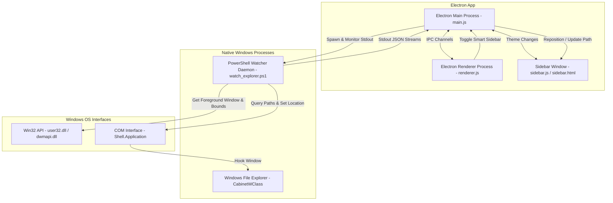

# 🌳 Folder Tree Explorer

[](https://opensource.org/licenses/ISC)
[](https://microsoft.com/windows)
[](https://www.electronjs.org/)
[](https://github.com/PowerShell/PowerShell)

**Folder Tree Explorer** is a sleek, modern desktop companion app for Windows. It provides a fast, customizable, side-by-side hierarchical tree view with rich in-app media previews, robust sorting/filtering, and a revolutionary **Smart Explorer Sidebar** mode that docks itself directly next to active Windows File Explorer windows.

---

## 📌 The Problem It Solves

While the native Windows File Explorer is capable, it has several limitations for power users and developers:
1. **Rigid Navigation Pane**: The built-in navigation pane does not support advanced directory filtering, size calculations, or complex sorting inside the tree itself.
2. **No Side-by-Side Previews**: Previewing markdown files, code, audio, and video requires opening external apps or using slow, non-configurable preview panes.
3. **No Direct Folder Companion Mode**: There is no official way to have a lightweight, persistent tree pane dock and follow you as you open and browse different directories in native File Explorer windows.

**Folder Tree Explorer** acts as the perfect companion. In its standalone form, it provides a feature-rich workspace with media players and syntax-highlighted viewers. In its **Smart Sidebar** mode, it attaches seamlessly to Windows File Explorer, transforming standard folder browsing with an interactive, side-by-side directory tree.

---

## 🛠️ Technical Details & Architecture

Folder Tree Explorer leverages Electron's multi-process architecture combined with a high-performance Windows API background watcher written in PowerShell.

### System Architecture



### 🧠 The Smart Explorer Sidebar (How it Works)

The **Smart Explorer Sidebar** integrates the desktop app directly into the operating system's windowing environment. Here is the technical breakdown of the integration pipeline:

1. **Lightweight Active Window Hooking**:
   The spawned PowerShell script runs a persistent loop (50ms tick rate). To prevent CPU usage spikes, it avoids heavy COM calls by first querying the Win32 `GetForegroundWindow()` and testing its class name via `GetClassName()`. It only triggers COM reflection if the active window matches the Windows Explorer class name (`CabinetWClass`).
2. **Window Docking & Bounds Calculations**:
   When an active Explorer window is detected, the script queries its outer boundaries using `GetWindowRect` and `DwmGetWindowAttribute` (to exclude native drop shadows). It then calculates the space needed for the sidebar (fixed at `320px`).
3. **Resizing the Native Explorer Window**:
   Using the Win32 `MoveWindow` API, the daemon shrinks the width of the target File Explorer window by `320px`. The Electron main process intercepts the window's geometry and anchors the borderless Electron `sidebarWindow` directly adjacent to the Explorer frame:
   $$\text{Sidebar}_x = \text{Explorer}_x + \text{Explorer}_{\text{width}}$$
   $$\text{Sidebar}_y = \text{Explorer}_y$$
4. **Real-time Path Synchronization**:
   The PowerShell script communicates with the native Explorer window using the COM interface `Shell.Application`. It extracts the current directory path:
   ```powershell
   $path = $targetWindow.Document.Folder.Self.Path
   ```
   This path is serialized into JSON and written to standard output. Electron parses the JSON stream, updates the sidebar window context, and triggers a tree re-render.
5. **Bidirectional Navigation**:
   * **Explorer to Sidebar**: Navigating folders inside File Explorer automatically updates the sidebar's tree view.
   * **Sidebar to Explorer**: Clicking a folder inside the sidebar triggers a standard input command (`navigate hwnd|path`) to the PowerShell process. The script matches the target handle (`HWND`) and invokes:
     ```powershell
     $targetWindow.Navigate($targetPath)
     ```
     This forces the native File Explorer window to navigate to the clicked folder.
6. **Graceful Window Restoration**:
   The script tracks the original boundaries of every docked Explorer window. When the sidebar is toggled off or the Electron app is closed, the watcher process restores all native Explorer windows to their original dimensions and exits.

---

## 📥 Download and Installation

Folder Tree Explorer comes with a fully configured Windows installer built using NSIS.

### Step 1: Download the Installer
1. Navigate to the **Releases** tab on the GitHub Repository page.
2. Download the latest installer executable: `Folder Tree Explorer-Setup-1.0.0.exe`.

### Step 2: Running the Setup Wizard
1. Double-click the downloaded setup file.
2. Select your installation directory (default is `%LOCALAPPDATA%\Programs\folder-tree`).
3. The installer will automatically:
   * Create a Start Menu shortcut.
   * Create a Desktop shortcut.
   * Configure all required file permissions.
4. Check the **Run Folder Tree Explorer** box on the final screen and click **Finish**.

---

## 💻 Developer Guide (Running from Source)

If you would like to run or build the application from source code, make sure you have [Node.js](https://nodejs.org/) installed.

### 1. Clone the Repository
```bash
git clone https://github.com/Danidu-Muhandiram/Windows-Explorer-Folder-Tree.git
cd Windows-Explorer-Folder-Tree
```

### 2. Install Dependencies
```bash
npm install
```

### 3. Run the App in Development Mode
This will launch Electron and open the main interface.
```bash
npm start
```

### 4. Build the Production Installer
This command bundles the code, compiles PowerShell helpers, and generates a standalone NSIS `.exe` installer inside the `release/` directory.
```bash
npm run build
```

---

## 📸 User Interface & Screenshots

### 1. Main Workspace
The standalone application offers a high-performance directory tree, filtering controls, sorting mechanisms, and a full file preview panel side-by-side.

 *Placeholder: Add your main workspace image here*

### 2. Smart Sidebar Docking
Toggle the **Smart Explorer Sidebar** option in the controls panel to automatically shrink and dock the Folder Tree to any active Windows File Explorer.

 *Placeholder: Add your docked sidebar image here*

### 3. Setup and Installation Wizard
The NSIS Installer handles desktop shortcut creation and launches the app directly after installation.

 *Placeholder: Add your installer wizard image here*

---

## ⚙️ Configuration & Storage

The application saves user preferences inside the browser's standard LocalStorage:
*   `theme`: Stores active color theme (`light` or `dark`).
*   `pinnedFolders`: Stores an array of absolute directories pinned in the Favorites section.

No configuration files are written outside the local app data registry, keeping the application light, portable, and clean.

---

## 📄 License

This project is licensed under the ISC License - see the [LICENSE](LICENSE) file for details.

Copyright © 2026 **D. Muhandiram**
