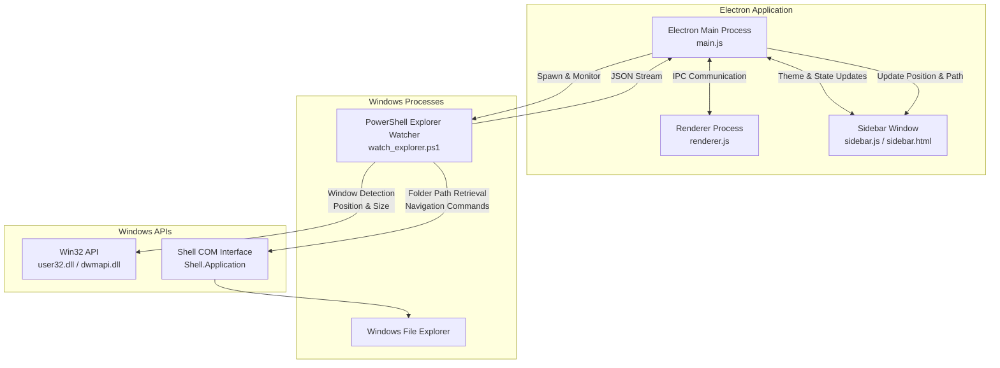

# 🌳 Folder Tree Explorer

[](https://opensource.org/licenses/ISC)
[](https://microsoft.com/windows)
[](https://www.electronjs.org/)
[](https://github.com/PowerShell/PowerShell)

**Folder Tree Explorer** is a modern Windows desktop application built with Electron that enhances the file management experience with a powerful folder tree, advanced filtering, file previews, and a unique **Smart Explorer Sidebar** that integrates directly with Windows File Explorer.

---

# 📌 The Problem It Solves

Windows File Explorer is a reliable and familiar tool for everyday file management. However, developers, designers, and power users working with large projects often need more advanced navigation and organization features.

Common limitations include:

- Managing large and deeply nested folder structures can become difficult.
- The default navigation panel provides limited customization.
- Previewing different file types often requires opening external applications.
- Frequently used folders are difficult to organize inside Explorer.
- There is no native way to attach a customizable folder tree beside File Explorer.

**Folder Tree Explorer improves this workflow by providing a powerful browsing environment while keeping the familiar Windows Explorer experience.**

| Windows File Explorer | Folder Tree Explorer |
| --------------------- | -------------------- |
| Basic folder navigation | Advanced hierarchical folder tree |
| Limited sorting and filtering | Flexible sorting and filtering options |
| Limited built-in previews | Integrated file preview system |
| No custom folder favorites | Pin important folders |
| Fixed navigation layout | Customizable workspace |
| No companion sidebar | Smart Explorer Sidebar integration |

Folder Tree Explorer is not designed to replace Windows File Explorer. Instead, it works as a productivity companion that extends its capabilities.

---

# ✨ Features

## 🌳 Advanced Folder Tree

- Fast hierarchical folder navigation
- Expand and collapse directories
- Browse large project structures easily
- Real-time folder synchronization

## 🔍 Search, Sorting & Filtering

- Search files and folders quickly
- Filter content by file type
- Sort items based on different properties

## 👀 Built-in File Preview

Preview files without opening separate applications.

Supported file types:

- 🖼️ Images
- 🎬 Videos
- 🎵 Audio files
- 📄 PDF documents
- 📝 Markdown files
- 💻 Source code files

## 📌 Favorites & Customization

- Pin frequently used folders
- Quickly access important directories
- Light and dark themes

---

# 🪟 Smart Explorer Sidebar

The **Smart Explorer Sidebar** is the key feature that differentiates Folder Tree Explorer from traditional file managers.

It creates a docked sidebar next to the active Windows File Explorer window and keeps the folder structure synchronized automatically.

## How It Works

1. The application detects the currently active File Explorer window.
2. A lightweight PowerShell watcher monitors Explorer activity.
3. The current folder path is extracted through the Windows Shell COM interface.
4. Electron receives updates and refreshes the sidebar tree.
5. Folder navigation can be performed from either Explorer or the sidebar.

## Benefits

- Browse folders without losing the native Explorer workflow.
- Keep a permanent folder tree beside Explorer.
- Quickly navigate large directory structures.
- Switch between Explorer windows seamlessly.

---

# 🏗️ System Architecture

Folder Tree Explorer uses Electron's multi-process architecture combined with Windows system APIs for Explorer integration.



---

# ⚙️ Smart Sidebar Technical Flow

## 1. Explorer Detection

A PowerShell background watcher continuously checks the active window.

To reduce resource usage:

- Win32 APIs detect the foreground window first.
- COM operations are only executed when the active window is Windows Explorer.

---

## 2. Window Docking

The application calculates the Explorer window position and places the sidebar beside it.

The Explorer window is resized to make space for the sidebar while maintaining the original layout.

---

## 3. Folder Synchronization

The watcher retrieves the current Explorer directory:

```powershell
$path = $targetWindow.Document.Folder.Self.Path
```

The path is converted into JSON and sent to Electron through standard output.

Electron then updates the sidebar tree automatically.

---

## 4. Two-Way Navigation

Navigation works in both directions:

### Explorer → Sidebar

Changing folders in File Explorer updates the sidebar automatically.

### Sidebar → Explorer

Selecting a folder inside the sidebar sends a command back to PowerShell, which navigates the Explorer window.

---

## 5. Window Restoration

When Smart Sidebar mode is disabled:

- Original Explorer dimensions are restored.
- Background watcher processes are closed.
- System resources are released.

---

# 🛠️ Built With

## Application

- Electron
- JavaScript
- HTML5
- CSS3

## Windows Integration

- PowerShell
- Windows Win32 API
- Windows Shell COM Interface

## Packaging

- NSIS Installer

---

# 📥 Installation

## Download Installer

1. Go to the **Releases** section.
2. Download:

```
Folder Tree Explorer-Setup-x.x.x.exe
```

3. Run the installer.
4. Follow the setup wizard.
5. Launch the application.

The installer creates:

- Start Menu shortcut
- Desktop shortcut
- Application files

---

# 💻 Running From Source

## Requirements

- Node.js
- npm

---

## Clone Repository

```bash
git clone https://github.com/Danidu-Muhandiram/Windows-Explorer-Folder-Tree.git

cd Windows-Explorer-Folder-Tree
```

---

## Install Dependencies

```bash
npm install
```

---

## Run Development Mode

```bash
npm start
```

---

## Build Installer

```bash
npm run build
```

The production installer will be generated in the release directory.

The production installer will be generated in the release directory.

---

# 📸 Screenshots

## Main Workspace

The standalone application provides folder navigation, sorting, filtering, and file previews.


## Smart Explorer Sidebar

The sidebar attaches beside Windows File Explorer and synchronizes with the active directory.


## Installer

The NSIS installer provides a simple installation experience.


---

# ⚙️ Configuration

The application stores user preferences locally.

Stored settings include:

- Selected theme
- Pinned folders

No external configuration files are required.

---

# 🔒 Privacy

Folder Tree Explorer operates completely locally.

- No account required
- No cloud services
- No file uploads
- No personal data collection

Your files remain on your device.

---

# 📄 License

This project is licensed under the **ISC License**.

See the [LICENSE](LICENSE) file for details.

Copyright © 2026 **D. Muhandiram**
